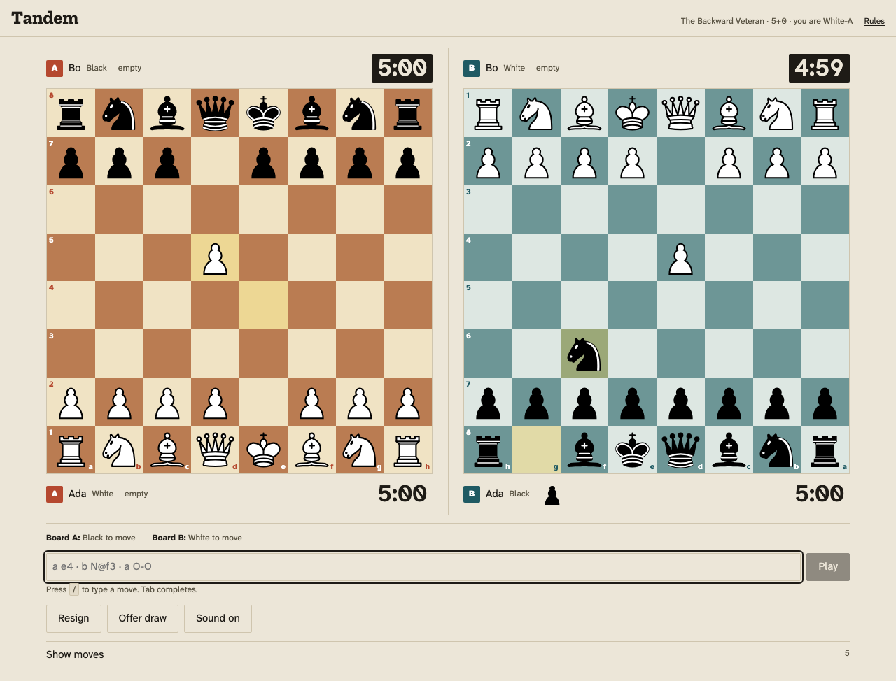

# Contents

| Section | Page |
|---|---|
| **Overview** | 4 |
| &nbsp;&nbsp;&nbsp;Status at a glance | 4 |
| **Part 1. Build brief** | 5 |
| &nbsp;&nbsp;&nbsp;0. Summary | 5 |
| &nbsp;&nbsp;&nbsp;1. Decisions locked by the user | 6 |
| &nbsp;&nbsp;&nbsp;2. Research basis and rulings | 6 |
| &nbsp;&nbsp;&nbsp;3. Rules specification (the engine contract) | 7 |
| &nbsp;&nbsp;&nbsp;4. Product scope | 10 |
| &nbsp;&nbsp;&nbsp;5. Interaction design | 10 |
| &nbsp;&nbsp;&nbsp;6. Technical architecture | 12 |
| &nbsp;&nbsp;&nbsp;7. Design: "Club table" (decided 2026-10-07) | 13 |
| &nbsp;&nbsp;&nbsp;8. Information architecture | 15 |
| &nbsp;&nbsp;&nbsp;9. Quality bars | 15 |
| &nbsp;&nbsp;&nbsp;10. Anti-slop checklist | 16 |
| &nbsp;&nbsp;&nbsp;11. Milestones and exit criteria | 16 |
| &nbsp;&nbsp;&nbsp;12. Approval gates | 16 |
| &nbsp;&nbsp;&nbsp;13. Risks | 17 |
| &nbsp;&nbsp;&nbsp;14. Decisions on previously open points (final; reversible on request) | 17 |
| &nbsp;&nbsp;&nbsp;14a. Review record | 17 |
| &nbsp;&nbsp;&nbsp;15. References | 17 |
| &nbsp;&nbsp;&nbsp;Changelog | 18 |
| **Part 2. Design system** | 20 |
| &nbsp;&nbsp;&nbsp;Principle | 20 |
| &nbsp;&nbsp;&nbsp;Surfaces | 20 |
| &nbsp;&nbsp;&nbsp;Colour | 20 |
| &nbsp;&nbsp;&nbsp;Type | 20 |
| &nbsp;&nbsp;&nbsp;Components | 20 |
| &nbsp;&nbsp;&nbsp;Motion | 21 |
| &nbsp;&nbsp;&nbsp;Copy | 21 |
| &nbsp;&nbsp;&nbsp;Rejection checklist (reference: wpbeaverbuilder.com/avoid-ai-slop-in-web-design) | 21 |
| &nbsp;&nbsp;&nbsp;Pieces and assets | 21 |
| **Appendices** | 22 |
| &nbsp;&nbsp;&nbsp;Appendix A. Design tokens (verbatim from `design/tokens.css`) | 22 |
| &nbsp;&nbsp;&nbsp;Appendix B. Rules engine | 23 |
| &nbsp;&nbsp;&nbsp;Appendix C. Third-party licences | 23 |
| &nbsp;&nbsp;&nbsp;Appendix D. File inventory | 25 |

# Overview

Tandem is an online two-player bughouse chess site where each player controls both boards, with one clock per board.

**Compiled 2026-10-08** from the project files. This is a read-only compilation; edit the source files (`BRIEF.md`, `DESIGN.md`, `THIRD_PARTY.md`, `design/tokens.css`), then rebuild with `python3 tools/build_master.py`.

## Status at a glance
| Area | State |
|---|---|
| Brief | v2.4, complete, no open questions |
| Visual direction | **Club table**, decided 2026-10-07 |
| Tokens, fonts, pieces, licences | Done and verified (`design/`, `THIRD_PARTY.md`) |
| Rules engine (M1) | Done. Run for this compilation: **81 tests passing** (5 files) |
| Server, client, replay, spectators, rules page (M2 to M5) | Done and reviewed |
| Hardening (M6) | Accessibility, performance and licences verified; see §9 |
| Dependencies | Two shipped (Svelte, ws), both MIT; all recorded in `THIRD_PARTY.md` |



# Part 1. Build brief

Status: **v2.4, 2026-10-07. Built, tested and reviewed.** The product described here exists: see `README.md` to run it. Sections 3 to 8 are the contract the code implements; where building it proved a section wrong, the section was corrected and the correction recorded in the changelog at the end.
Working title: **Tandem** (placeholder, §14).

Reading guide: "must" is a requirement; "default" is a decision the user may reverse; every number in this document is a decision, not a suggestion.

---

## 0. Summary

A website where two people play real-time bughouse chess online, and **each person controls both boards**. Player 1 plays White on Board A and Black on Board B. Player 2 plays Black on A and White on B. A player's two seats are partners, so every piece captured on one board goes straight into *the same player's* reserve on the other board. The game turns on attention, timing and piece flow instead of partner coordination.

**The bet, stated plainly so it can be argued with.** Bughouse is normally a
four-player game, and its hardest problem is getting four people to the table at the
same time. This trades the partner for a second board: you lose the shouting and the
blaming, and you gain a game two people can start in one click. Whether that trade is
worth making is the premise the whole product rests on, and it is untested.

There is **one clock per board.** Each is a normal two-sided chess clock, so each of the four seats has its own time bank. A player cannot ignore a board without paying for it in time. Rules follow established bughouse rules (§3). The design is the "Club table" direction (§7), chosen to avoid the AI-generic look and our earlier dark, data-dense projects.

### 0.1 Glossary (words are used only in these senses)
| Term | Meaning |
|---|---|
| Table | The pre-game room at `/t/:id`, before and during setup |
| Game | One played game from the start signal to a result |
| Board A / Board B | The two boards. A is always on the left, B on the right |
| Seat | One side of one board: `A-w`, `A-b`, `B-w`, `B-b` |
| Team | The two partner seats owned by one human: **Team White-A** = `A-w` + `B-b`; **Team Black-A** = `A-b` + `B-w` |
| Reserve | Pieces a seat may drop. Never "pocket", "bank" or "hand" in the UI |
| Drop | Placing a reserve piece on an empty square as the seat's action |
| Action | A move or a drop |
| Pending | In check, nothing legal now, but a dropped piece could block (§3.4) |
| Counterfeit | A promoted piece, which becomes a pawn when captured |

---

## 1. Decisions locked by the user

| # | Decision | When |
|---|---|---|
| D1 | Online 1v1, two devices, shared link, real-time server | 2026-10-06 |
| D2 | Each human controls both boards (two partner seats) | 2026-10-06 |
| D3 | **One clock per board** (classic bughouse clocks), replacing the earlier "one clock for both boards", so players are forced to play both boards | 2026-10-06 |
| D4 | Drops may give check and checkmate | 2026-10-06 |
| D5 | All other rules follow the official/standard bughouse ruleset (§3) | 2026-10-06 |
| D6 | Time control is chosen in the table by the host | 2026-10-06 |
| D7 | Clean, organized UI. Not like previous projects. Not generic AI output | 2026-10-06 |
| D8 | **Visual direction: "Club table"** | 2026-10-07 |
| D9 | Fonts must not look like AI defaults (replaced, §7.4) | 2026-10-07 |

**Consequence of D2 + D3:** the two boards run **concurrently in real time**, as in 4-player bughouse. This is not the fixed-rotation turn order of single-clock "simultaneous bughouse" (WhiteA → WhiteB → BlackB → BlackA). With one clock per board a rotation has no function, so it is not used. At any moment a player may have the move on both boards, one, or neither, and chooses where to spend attention. Each seat's clock runs only while it is that seat's move on its board.

---

## 2. Research basis and rulings

Sources (links in §15): Wikipedia "Bughouse chess", the wccc2007 "Laws of Bughouse" PDFs, the pion.ch complete ruleset, the chess.com Help Center bughouse article, the wikibooks Bug House page, and lichess/TalkChess discussions for the castling question. They agree on the core. There is **no FIDE-endorsed bughouse ruleset**, so sites and tournaments differ at the margins.

**Confirmed by at least one source:**
- Teams are partners across boards: White on A + Black on B against Black on A + White on B.
- A captured piece goes to the capturer's partner immediately and keeps its own colour, which is the partner's colour.
- A turn is a normal move **or** a drop on any empty square.
- Pawns cannot be dropped on rank 1 or rank 8. A pawn on its own second rank (rank 7 for Black), including one just dropped there, may double-step. A dropped pawn can be captured en passant.
- Promoted pieces revert to pawns when captured.
- A check that a dropped piece could block is **not** checkmate, even if the reserve is empty. Mate therefore needs a check that cannot be blocked by a drop: contact check, knight check, pawn check, double check, or a slider check with no empty square between.
- Stalemate does not exist: a side with no legal action waits.
- The game ends when either board ends (mate, resignation, flag).
- Drops may give check or mate in the standard rules (a shogi-style ban is a stated variant, rejected by D4).

**Not settled by any authority, so decided here:**
- **U1. Castling with a dropped rook.** Wikipedia: a rook dropped on a1/h1/a8/h8 may take part in castling. Lichess forbids it in *crazyhouse*, which is a different game, and discussions show disagreement. **Default: allowed**, requiring the king to be unmoved and the rook to have arrived on its corner by drop or never to have left it. It sits behind an engine flag `droppedRookCastling`, and the /rules page states the choice.
- **U2. Promotion choices.** OTB rulesets say "queen or knight" mainly because the pawn physically stays a pawn. **Default: Q, R, B or N.**
- **U3. Repetition and 50-move draws.** No standard definition exists and clocks always end the game. **Default: none** (§3.9).
- **U4. Piece set.** **Decided: Cburnett** (author Cburnett). All twelve SVGs were confirmed as **CC BY-SA 3.0** through the Wikimedia Commons API, so that is the licence we rely on (the author also offers GFDL, GPL and BSD on at least one file). Attribution is shown on /rules. Recorded in `THIRD_PARTY.md`. A custom set is a possible later upgrade, not v1.

---

## 3. Rules specification (the engine contract)

### 3.1 Setup
- Two standard boards, each in the standard starting position.
- Seats and partners: `A-w`↔`B-b` (Team White-A) and `A-b`↔`B-w` (Team Black-A).
- **Human 1** owns one team and **Human 2** the other (assignment in §4.1).
- Each seat's time bank starts at the table's base time.
- Colour never changes. A White piece captured on Board A (by `A-b`) goes to the reserve of `B-w`, still White. Every reserve therefore holds pieces of its seat's own colour.

### 3.2 Actions
An action is either:
1. **Move.** Standard chess movement, including castling, en passant and promotion.
2. **Drop.** Take a piece from the seat's own reserve and place it on any empty square of the seat's board.

Constraints:
- No action may leave your own king attacked. In check, only a move that resolves the check or a drop that blocks it is legal.
- **Pawn drops:** never on rank 1 or rank 8 (absolute ranks, both colours).
- **Double step:** a pawn that stands on its own second rank (rank 2 for White, rank 7 for Black) may advance two squares if both squares are empty. This includes a pawn just dropped there. A pawn dropped on any other rank advances one square.
- En passant works against dropped pawns exactly as against any pawn.
- Dropped pawns promote normally.
- Kings are never captured and never dropped.
- A seat may act only when it is that seat's turn on its board.

### 3.3 Capture transfer
- A capture on board X by seat S adds the captured piece to the reserve of S's partner seat on the other board. It becomes available at the instant the capturing action is applied, and the partner seat may use it **the next time that seat has the move**.
- **Promoted pieces** carry a `promoted` flag from promotion onward, kept as the piece moves. A captured promoted piece enters the reserve as a **pawn**.
- A capture that also gives check or mate still transfers its piece.
- En passant transfers a pawn.

### 3.4 Check, checkmate and pending
Applies to the seat to move, when its king is attacked. A **slider** is a bishop, rook or queen.

1. **Check:** at least one legal action exists with the reserve held now. Play continues.
2. **Checkmate:** no legal action exists now, **and** no drop could ever block. That means any of: more than one attacker (double check), an attacker that is a knight or pawn, or a slider attacker with no empty square between it and the king.
3. **Pending:** no legal action exists now, but exactly one slider attacks and at least one empty square lies between it and the king, so a dropped piece could block. The side is **not mated**. Its clock keeps running, and it may act as soon as its reserve (fed by its partner seat) gives it a legal block, or it may lose by flag or resignation. While pending, its opponent on that board cannot move, because it is not their turn.

A block square on rank 1 or rank 8 can only be filled by a non-pawn. Pending still applies, because a non-pawn could arrive.

Because a player's partner seat is also themselves, pending is rarely luck: they can usually produce the needed piece by capturing on their other board, if the clock allows.

### 3.5 No stalemate
A side with no legal action that is **not** in check is called **stuck**. It is neither stalemated nor drawn. It waits with its clock running until a piece arrives or it flags. If neither seat on a board can act, that board is frozen until the other board changes a reserve or a clock expires.

### 3.6 End of game
The game ends at the first of these events:

| Event | Result |
|---|---|
| Checkmate on either board (§3.4 rule 2) | The team of the mated seat loses |
| Flag: a seat's time bank reaches 0 while its clock runs | The team of that seat loses. Flag is a loss even if the opponent could never mate; there is no insufficient-material rule |
| Resignation | The resigning human's team loses. It ends the whole game, not one board |
| Draw by agreement | Draw (§3.6.2) |
| Abandonment | §6.5 |
| Abort | No result, §3.7.1 |

#### 3.6.1 Order of events (deterministic)
- The server processes events in the order it receives them, one at a time.
- An action is accepted only if its server receive time (after lag credit, §6.2) is **at or before** the mover's flag deadline. An action received exactly at the deadline is accepted. Otherwise the flag event happens first and the action is discarded.
- Two game-ending events cannot come from two actions, because actions are serialized. They can only be two flags whose deadlines fall on the same millisecond. Then: if both seats belong to the **same team**, that team loses; if they belong to **different teams**, each team has lost one board, so the game is a **draw**.

#### 3.6.2 Draw offers
- A human offers a draw; the other accepts or declines.
- An offer expires after 30 s, when the opponent declines, or when the game ends.
- At most one offer is pending. After a declined or expired offer, the same human may not offer again for 60 s.

### 3.7 Clocks
- Four time banks, one per seat. On each board only the seat to move has a running clock, so at most two clocks run at once, one per board. A frozen board (§3.5) is frozen in position only: the side to move there keeps burning its clock and will flag unless a piece reaches it.
- **Time control** (set by the host, default 5+0): base 1 to 30 minutes in whole minutes, applied to **each of the four seats**; increment 0 to 10 s in whole seconds. Presets: 1+0, 2+0, 3+0, 5+0, 10+0, 3+2, and custom. Standard bughouse has no increment; the default has none.
- **Increment:** Fischer. After each accepted action by a seat, add the increment to that seat's time bank, applied on the same board's clock. Not added on a flag.
- Time spent pending, stuck or deciding still runs.
- Display: at 10 s or more, `m:ss`; under 10 s, `s.t` (e.g. `9.4`). **Low time** is when a running clock is at or below `min(20 s, 10% of base)`.

#### 3.7.1 Start and abort
- The game starts when both humans have pressed Ready, followed by a 3 s countdown. At the end of the countdown (`t0`), the White seat clocks on both boards start.
- If **neither** human has made any action 30 s after `t0`, the game is **aborted** with no result and no rematch penalty. Once any action has been made, only flags and the other end events in §3.6 apply.

### 3.8 Illegal input
The UI never offers illegal actions, and the server rejects them. There is no "illegal move loses" rule (that polices physical play). A rejected action reverts with a short message. A rejection never costs time beyond what elapsed.

### 3.8a Known gap: the pending stall race

These rules permit a position where the correct play is to make no play, and this is
reachable rather than theoretical (`packages/server/test/stall.test.ts` reaches it).

A side that is pending on one board (§3.4 rule 3) can only obtain a blocking piece by
capturing on the other board, which requires its turn there. If the opponent holds that
turn and simply declines to use it, neither position can change again. Both running
clocks burn at the same rate, so the game is decided entirely by which clock was
further ahead when the stall began. No chess is played from that point.

§3.9 justifies having no draw rules with "clocks always end the game". In this case the
clock ending the game *is* the degenerate outcome, not the safeguard against it. The
abort rule (§3.7.1) does not help: it only covers a game in which nothing was ever
played.

**Unresolved.** Three candidate rules, none yet chosen:
1. Adjudicate or draw a board whose position has not changed for N seconds.
2. Let a pending side claim a draw after N seconds.
3. Define repetition over the whole state (both positions and all four reserves) and
   allow a threefold claim. "No authority defines it" is a reason not to copy a rule,
   not a reason to have none.

Option 2 is the cheapest and the least likely to surprise a player. This is a decision
about the game rather than about the code, so it is recorded here and left to the user.

### 3.9 Deliberately absent
No threefold repetition, no 50-move rule, no insufficient-material draw, no stalemate. Reserves and the other board change the state continually, no standard definition exists, and clocks always end the game. The /rules page says so. **The reasoning has one hole, recorded in §3.8a:** when neither side can move, the clock ending the game is the degenerate outcome rather than the safeguard.

### 3.10 Notation and export
- Standard algebraic notation. Drops: `N@f3`, `P@e4`. Check `+`, mate `#`, promotion `e8=Q`, castling `O-O`/`O-O-O`.
- **Text export**, one line per action in order of server time: `<board>.<color> <notation> {<mover's remaining time after the action>}`, e.g. `A.w e4 {4:58.2}`, `B.b N@f3+ {3:41.0}`. A header of `Event`, `Date`, `Result`, `TimeControl`, `TeamWhiteA`, `TeamBlackA`.
- **JSON export:** the same list with `board`, `color`, `action`, `serverTs`, `clocks` after each action, plus the header and result.

---

## 4. Product scope

### 4.1 In v1
1. **Create a table.** The host chooses a time control and a team (Team White-A, Team Black-A, or random, resolved at the start of the game). The table has a link `/t/:id`.
2. **Join.** The first visitor who is not the host takes the other team. Anyone later is sent to the spectator view. A seat survives refresh through a seat token (§6.6). Guests enter a display name: 1 to 20 characters, letters, digits, space, `_` `-` `.`, trimmed; blank means `Guest` plus four digits; remembered locally.
3. **Table setup.** The host may change the time control or team until the guest has pressed Ready. Any change clears both Ready flags. An unjoined table expires after 30 minutes.
4. **Play.** Two live boards, four clocks, four reserves, drag-and-drop and click-click for moves and drops, keyboard entry, premoves, synthesized sounds, resign, draw offer.
5. **Result screen.** Winner and reason in one plain sentence, both final positions, the action list, and a rematch button. **Rematch:** either human can request it, the other has 60 s to accept, teams swap, settings are unchanged.
6. **Replay** at `/g/:id` (the same id; `/t/:id` forwards there when the game is finished): a timeline over the merged action list with step keys, both boards and all four reserves and clocks as recorded.
7. **Spectators** at `/watch/:id`: read-only, up to 50 concurrent, count shown to players. Orientation defaults to Team White-A's view, with a flip toggle.
8. **/rules:** the full ruleset with interactive mini-boards for each non-obvious rule (drop, counterfeit, pending, no stalemate, dropped-rook castling).
9. **Reconnect:** closing the tab or losing connection mid-game restores the same state on return (§6.4, §6.5).
10. **Export:** §3.10.

### 4.2 Not in v1
Accounts, ratings, matchmaking and public lobby, chat, four-human mode, computer opponent, tournaments, native apps, dark theme, languages other than English. A game record stores seats rather than accounts so accounts can be added later.

### 4.3 Supported browsers
Latest two versions of Chrome, Edge, Firefox and Safari (including iOS Safari 16 and later). Touch and pointer are both first-class.

---

## 5. Interaction design

### 5.1 The attention problem
The product's real subject is divided attention. Every screen element serves one of four questions: *what is the time on each board, which board needs me, what is in my reserve, what is my opponent about to receive.*

### 5.2 Layout, viewport width ≥ 1100 px
Two boards side by side, A left and B right, joined by a **spine** `44 px` wide.
- **Strips:** each board has a top strip (the opponent seat) and a bottom strip (your seat). A strip contains, left to right: board badge (letter on the board's accent colour), name, seat colour, the seat's reserve, and the clock.
- **Orientation:** your pieces are at the bottom on both boards. For Team White-A that means Board A is shown with White at the bottom and Board B with Black at the bottom (flipped). For Team Black-A it is the reverse. This matches how bughouse is played physically.
- **Board identity:** A and B differ by accent colour, by the letter badge, and by fixed position. Colour is never the only cue.
- **Your move marker:** the seat that has the move on a board has its clock on a dark ground (`--clock-run-bg`). Opposite seats' clocks stay on the page ground. No other marker is used for "your turn".
- **Check and pending marker:** the king's square carries a 3 px ring in the alert colour, and the status line under the boards names the board and state in words (e.g. "Board B: check, Black to move" or "Board A: pending, needs a blocking piece").
- **Reserves:** pieces in a row with a count badge for counts above one. The opponent's reserve is shown at 80% size (24 px against 30 px) but is always visible, because it is tactical information.
- **Spine:** when a capture transfers a piece, the piece travels from the capturing board across the spine into the partner reserve in 420 ms (`--t-transfer`). It warns the opponent that you gained a piece. Under `prefers-reduced-motion` there is no travel: the reserve updates with a brief highlight.
- **Move list:** a single merged, timestamped list in a collapsible panel to the right, filterable by board. Closed by default during play.
- **Status line:** under the boards, one line per board in plain words (§7.6).

### 5.3 Layout, smaller viewports
- **600 to 1099 px wide:** boards stay side by side; strips and the spine shrink; reserves go to a single row.
- **Under 600 px, portrait:** boards are **stacked** (A above B) with the spine horizontal between them. The height budget is measured at runtime: the viewport, less the board area's offset from the top of the document, less the status line, which must stay visible while playing. The controls below it may fall under the fold on a short screen. Measuring from the *document* top matters: a viewport-relative measurement changes when the page scrolls and would resize the boards mid-game.
- **Minimum square size is 34 px.** When two stacked boards cannot both reach it, switch to **focus mode**: the board you are playing takes the full width and the other becomes a 144 px mini board, both keeping their clocks and reserves; tapping the mini board swaps them. A 2 px hysteresis band stops the layout flipping back and forth at the boundary.
- **Measured result.** On a 390 × 844 phone this is focus mode: the played board gets **44 px squares** and the mini board 18 px. An earlier draft of this section claimed two full boards at 36 px squares on the same phone; that arithmetic assumed a 40 px header and nothing below the boards, and does not survive a real status line, move line and controls. Two full boards at 34 px squares need 744 px of vertical space before any chrome, so on a phone focus mode is the normal case, not the exception. `e2e/layout.spec.ts` asserts the floor at every width.
- **Phone landscape:** boards side by side, sized by height with the same 34 px floor.
- Drag and tap targets are never smaller than the squares. Drops: drag from the reserve, or tap a reserve piece and then a square.

### 5.4 Input methods
- **Pointer:** drag-and-drop and click-click for both moves and drops. Legal targets show as small dots.
- **Premove:** while it is not your turn on a board, you may queue **one** action there (a move, or a drop of a piece currently in the reserve). When your turn on that board begins, the client sends the queued action at once, and the server validates it normally. If rejected, the premove is dropped silently with a brief mark on the square. Cancel with Esc, right-click, or clicking the origin square.
- **Keyboard command line:** open with `/` or Enter. Grammar: `<board> <notation>` where board is `a` or `b` (case-insensitive) and notation is the algebraic notation of §3.10, e.g. `a e4`, `b N@f3`, `a O-O`, `b e8=Q`. The board prefix may be omitted when the notation is legal on exactly one board where you hold the move; if it is legal on both, the line shows "legal on A and B, add a or b". The line autocompletes from the legal-action list. Enter submits; Esc closes.
- **Keyboard navigation:** `Tab` cycles regions (board A, board B, reserve, command line, controls). `1` and `2` jump to board A and B. Arrow keys move the square cursor; Enter selects and then places; Esc cancels.
- **Destructive controls:** Resign and Offer draw each need a second confirming click within 5 s.

### 5.5 Feedback
- **Sound** is synthesized with the Web Audio API, so no audio files exist and none need licensing. Cues: move, capture, drop, check, low-time (once, when your running clock crosses the low-time threshold), game end. Default on at 30% gain, with a per-user mute remembered locally.
- Last-action highlights per board (`--last-move`).
- A status line per board (§5.2).

### 5.6 Accessibility
- Everything possible with a pointer is possible with the keyboard alone (§5.4).
- An ARIA live region announces each action with its board and seat, rate-limited to one announcement per second per board; low time and results are announced immediately.
- Text contrast ≥ 4.5:1, UI components ≥ 3:1 (the measured table is in §7.3).
- `prefers-reduced-motion` is honoured. There is no dark mode in v1, so `prefers-color-scheme` is deliberately not used.
- Piece identity never depends on colour alone; a promoted piece shows a small marker in addition to its normal glyph.
- Clock numerals have text alternatives through the live region and `aria-label`s on the clock strips.

---

## 6. Technical architecture

### 6.1 Stack (decided)
- TypeScript throughout. npm workspaces: `packages/engine`, `packages/server`, `packages/web`.
- **Client: Vite + Svelte 5 SPA.** Chosen for small bundles and a reactive model that suits four frequently updating clocks. (React is not used.)
- **Server and hosting: Cloudflare Workers + Durable Objects**, one object per game. A Durable Object serializes all events (deterministic ordering across the two boards), holds the WebSockets, and uses alarms for flag timeouts. The client is served from the same platform. Vercel is not used because it cannot hold long-lived WebSockets.
- **Persistence: Cloudflare D1** for finished games; retention 90 days.
- **Contingency:** if Durable Objects prove unworkable (alarm precision or WebSocket limits found in M3 testing), switch to Node + `ws` on Fly.io with the same `engine` package. This is a fallback with a defined trigger, not a co-equal option.
- Test tooling: Vitest, Playwright, axe.

### 6.2 Authoritative server and clocks
- The server alone decides legality, clocks and results. Clients render and request.
- A clock is stored as `(remainingMs at lastEventTs, running)`. Clients interpolate from a server-synchronised offset and never decide a flag.
- A flag is detected by a Durable Object alarm set to the earliest running deadline and rescheduled after every action.
- **Lag credit:** per accepted action, the server credits the mover `min(RTT/2, 150 ms)`, where RTT is the median of the player's last five ping measurements (pings every 5 s). The credit is added back to the mover's bank, and never more than the time elapsed on that move.
- All events are serialised in the object, which makes cross-board effects (reserves) consistent. An attempt to drop a piece in the same instant as the capture that supplies it is decided by arrival order.
- Event-order and tie rules: §3.6.1.

### 6.3 Engine (built; M1 done)
Source of truth: `packages/engine`. Shape as implemented:
- `Game = { pos: {A, B}, reserve: {A: {w, b}, B: {w, b}}, opts }` where `reserve[board][color]` is the reserve of that seat.
- `legal(game, board)`, `apply(game, board, action) → { game, captured, transfer }`, `status(game, board)` returning `ok | check | pending | mate | stuck`, and `result(game)` for mate on either board. Clocks, flags, resign and draws live in the server, not the engine.
- Verified in `npm test`: perft and 300 random playouts against `chessops` Crazyhouse (single-board legality), 35 named bughouse scenarios, and 400 random two-board games asserting that the piece census is conserved (32 pieces of each colour; promoted pieces counted as pawns) and that every legal action applies. Nine deliberate rule breaks each made the suite fail.

### 6.4 Protocol
Messages are JSON, schema-validated on both sides, each server message carrying a monotonically increasing `seq`.
- Client → server: `join{name, seatToken?}`, `claimWin`, `setup{timeControl, team}` (host only, before Ready), `ready{value}`, `action{board, action}` (move: `from,to,promo?`; drop: `piece,to`), `resign`, `drawOffer`, `drawAccept`, `drawDecline`, `rematch`, `ping{t}`.
- Server → client: `snapshot{full state, seq}`, `action{board, action, seq, serverTs, clocks}`, `reject{reason}`, `ended{result, reason}`, `presence{seat, connected}`, `drawOffered`, `pong{t, serverTs}`.
- Gap in `seq` → the client asks for a snapshot. Reconnect uses the same path.
- Added during the build: `rename{name}` (client → server), so a name typed in the lobby reaches the other player; and an unsolicited `pong` used as a latency probe, which the client echoes as a `ping` so the server measures round-trip time itself rather than trusting a client-reported figure. The lag credit is capped at 150 ms either way.
- A `joined` message is re-sent to a connection whenever its seat moves between teams — the host choosing a side, a random draw resolving, or a rematch swapping sides — so the client is never left believing it holds its old team.

### 6.5 Presence and abandonment
- A human is **disconnected** after their last WebSocket closes. Clocks keep running.
- After **60 s** of continuous disconnection, the connected opponent may press "Claim win"; the server verifies the disconnection before awarding it. If the disconnected human reconnects first, play continues.
- If **both** humans are disconnected for **5 minutes**, the game is voided: no result.

### 6.6 Identity and security
- Table ids are 8 characters from a 32-symbol alphabet without look-alike characters (about 40 bits), unguessable and unlisted.
- A seat is claimed with a random 128-bit seat token held in local storage and presented on connect. Spectators have no token and cannot send actions.
- Rate limits per connection (30 messages per second); the server rejects any message failing schema validation.
- No third-party trackers or analytics in v1.

---

## 7. Design: "Club table" (decided 2026-10-07)

Sources of truth: [DESIGN.md](DESIGN.md) for decisions and [design/tokens.css](design/tokens.css) for values. A rendered reference of the game screen is [design/preview.html](design/preview.html). The two alternates (Ledger, Reading room) were rejected and remain in `gate1/` only for the record.

### 7.1 What the reference article says, and how it is applied
Reference: Leah Finch, **"How to Avoid AI Slop in Web Design: A Beaver Builder AI Masterclass with Paul Lacey"**, Beaver Builder, 11 September 2026, [`https://www.wpbeaverbuilder.com/avoid-ai-slop-in-web-design/`](https://www.wpbeaverbuilder.com/avoid-ai-slop-in-web-design/), read in full on 2026-10-06. The points used:
- **AI fills every unspecified decision with its defaults** ("If you don't decide, the AI decides for you"). Cure: decide every design variable explicitly (DESIGN.md) and keep approval gates (§12).
- **Named hallmarks:** repeated eyebrow labels and decorative monospace captions above headings; headlines with italicised words, gradients and dramatic three-part slogans; glassmorphism, translucent cards, floating gradients, boxes nested inside boxes. These are turned into the rejection checklist (§10).
- **The techniques are not banned, only unjustified.** Our test: each visual device must say what it does for a bughouse player, or be cut.
- **Too few rules produced slop, too many produced safe and uninspired work.** Hence a short token set (the tokens file is about 50 lines) plus one explicit checklist, not a long style guide.
- **Approval gates** on style tiles, typography, colour and then the main screen before building the rest, which §12 adopts.

### 7.2 Default reflex against decision
| Default reflex | Decision |
|---|---|
| Dark navy/black UI with a neon accent | Warm matte light "club table"; the boards are the only saturated objects |
| Inter, JetBrains Mono, Space Grotesk, Playfair (and what earlier projects used) | **Atkinson Hyperlegible Next** for UI and clocks, **Zilla Slab** for titles only. No monospace |
| Hero with gradient, tagline and three feature cards | No hero. The first screen is the table form beside a live engine-driven demo of a capture crossing between boards |
| Rounded cards, soft shadows, glass | Flat panels divided by 1 px rules; 2 px radius on controls; boards and panels square; no shadows |
| Decorative icons and emoji | The chess pieces and a minimal functional icon set (resign, draw, mute, move list); no emoji |
| Pulsing red low-time alarm | The clock ground becomes solid alert colour and the weight increases to 800; plus one sound cue; no animation loop |
| Centered, symmetric layout | Board-first layout dictated by the two-board geometry and the spine |

### 7.3 Palette (final; contrast measured 2026-10-07)
| Token | Value |
|---|---|
| Page / panel / rule | `#ECE6D8` / `#E3DBC9` / `#CFC5AE` |
| Ink / secondary ink | `#1E1B16` / `#5A5444` |
| Board A: light / dark square / accent | `#F0E3C4` / `#BA7C52` / `#B5482F` (clay) |
| Board B: light / dark square / accent | `#DDE7E2` / `#6D9696` / `#1F5A63` (deep teal) |
| Alert (check, pending, low time) | `#C2410C` |
| Running clock | background `#1E1B16`, text `#ECE6D8` |

Measured contrast ratios: ink on page 13.8; secondary ink on page 6.1 and on panel 5.5; white on clay badge 5.3; white on teal badge 7.8; running clock text 13.8; white on alert 5.2; clay against page 4.3; teal against page 6.3; black pieces on A dark 5.5, on B dark 5.8; white pieces on A dark 3.5, on B dark 3.3 (light-piece outlines carry the rest). The first draft's A dark square (`#C58A5F`) gave 2.9 for white pieces and was darkened to `#BA7C52`.

### 7.4 Typography (final)
- **UI, body and clocks: Atkinson Hyperlegible Next** (variable, 400 to 800). Designed by the Braille Institute to keep similar characters apart (0/8, 1/l), which matters for a clock read at a glance. Tabular numerals were verified (equal width for `1111` and `0000`).
- **Titles, wordmark and result line only: Zilla Slab** (600 and 700). A slab with a scoresheet feel; not a typical AI default.
- Scale: clock 36 px (28 px under 640 px), title 28 px, body 15 px, small 13 px (the minimum text size).
- Self-hosted latin subsets in `design/fonts/` with `font-display: swap`; the clock font is preloaded. Both families are SIL OFL 1.1, confirmed from the google/fonts repository; the licence texts are saved beside the fonts and recorded in `THIRD_PARTY.md`.
- Replaced: Schibsted Grotesk and Young Serif (the first draft). Evaluated and rejected: Archivo, Familjen Grotesk, Hanken Grotesk, Literata, Gloock, Source Serif 4.

### 7.5 Components, each with a reason
- **Clock strip:** the largest numerals on screen, next to the board edge. No skeuomorphic clock faces.
- **Reserve row:** pieces with count badges; the opponent's slightly smaller.
- **Spine:** the capture-transfer travel (§5.2).
- **Result screen:** one plain sentence of who won and why, both final boards, the action list. No confetti.

### 7.6 Copy
Dry, concrete, second person, no slogans, no exclamation marks, no "Not X. It's Y." constructions. Examples: "Set a table", "Waiting for your opponent", "Board B: Black to move, 0:42", "Board A: pending, needs a blocking piece", "Black wins on Board B: checkmate".

### 7.7 Pieces
Cburnett SVGs (§2 U4, files in `design/pieces/`), shown at 92% of the square. Legibility is verified at 36 px squares in the preview.

---

## 8. Information architecture

| Route | Purpose |
|---|---|
| `/` | Set a table (time control, team) and the demo boards |
| `/t/:id` | Table → game (single page with states: setup, countdown, playing, result); forwards to `/g/:id` once finished |
| `/g/:id` | Finished-game replay |
| `/watch/:id` | Spectator view |
| `/rules` | Full rules with interactive mini-boards |

Unknown id → a plain "no such table" page with a link to `/`. No about, pricing or blog pages.

---

## 9. Quality bars

### 9.1 Rules tests (exist; must stay green)
- Perft comparison against `chessops` Crazyhouse to depth 3 on 11 positions (depth 4 on the initial position), plus 300 random games of 60 plies comparing move counts at every ply.
- Named scenarios for each rule in §3 (transfer colour and seat, counterfeits, drop legality including in check, pawn drop ranks, double step, en passant on dropped pawns, promotion choices, check/mate/pending/stuck, dropped-rook castling on both flag settings).
- Property tests: piece-census conservation over 400 random two-board games; every legal action applies; reserves never negative; two kings per board.
- Mutation discipline: every key rule has a deliberate-break check that must make the suite fail. Server-layer rules (clock order, ties, increments, lag credit, abort, abandonment) must get the same treatment in M3.

### 9.2 Server tests
Clock accuracy under simulated latency; event ordering including §3.6.1 cases (action at the deadline, simultaneous flags for same and different teams); alarm flags; reconnect and snapshot resync; abandonment claim; abort; message-validation fuzzing; rate limiting.

### 9.3 End-to-end (Playwright, two browser contexts)
Scripted full game: create → join → ready → opening moves on both boards → capture → transfer → drop → mate. A second game ending on a flag on Board B. A pending-mate game resolved by a drop. Reconnect mid-game. Spectator is read-only. Replay scrub. Visual snapshots at 1280, 768 and 390 widths. axe audit. A keyboard-only playthrough.

### 9.4 Performance and licensing
- Measured with Lighthouse using its mobile preset on the production build: **initial-route JavaScript ≤ 150 KB gzipped** (fonts and piece SVGs excluded), **LCP < 1.5 s**, and 60 fps during drags and the spine animation in the browser performance trace.
- `THIRD_PARTY.md` records licence, author and source URL for the pieces, the fonts and every runtime dependency.

---

## 10. Anti-slop checklist
**Who enforces:** the builder runs it before every gate; the `/design-review` skill is run before Gates 3 and 4. A change is rejected if any of these is true:
- an eyebrow or kicker label, or decorative monospace caption, above a heading
- italic-accent word headlines, gradient text, or three-beat slogans
- glassmorphism, translucent panels, glows, floating gradient blobs
- a container nested inside another container without a functional reason
- three identical feature cards
- emoji or stock icons used as decoration
- a colour, shadow, radius or animation that cannot be justified in one sentence for a player
- any value (font, size, space, radius, easing) not present in `design/tokens.css`

---

## 11. Milestones and exit criteria

| M | Deliverable | Exit criterion | Status |
|---|---|---|---|
| M0 | `DESIGN.md`, `design/tokens.css`, fonts, pieces, `THIRD_PARTY.md` | Direction approved, contrast measured, licences recorded | Done 2026-10-07: direction, tokens, fonts, pieces, licences verified |
| M1 | `engine` package | §9.1 green | **Done 2026-10-07** |
| M2 | Local two-seat prototype (no network) | One person plays a full game against themself on both boards | Folded into M3: the server was built first and the two-browser path covers it. **Done 2026-10-07** |
| M3 | Server rooms, clocks, protocol | Two browsers complete a game; §9.2 green | **Done 2026-10-07** |
| M4 | Full UI, responsive, keyboard entry, premoves, spine | §9.3 passes at three widths | **Done 2026-10-07** |
| M5 | Replay, spectators, export, rematch, /rules | All of §4.1 shipped | **Done 2026-10-07** |
| M6 | Hardening | §9 bars met | Accessibility, performance and licences done 2026-10-08. **The Cloudflare adapter has never been run**; see `TODOS.md` |

---

## 12. Approval gates
- **Gate 0:** brief. Reviewed and revised at the user's direction; final export requested 2026-10-07.
- **Gate 1:** visual direction. **Closed 2026-10-07: Club table.**
- **Gate 2:** rules engine green. **Closed 2026-10-07.**
- **Gate 3: OPEN.** The user plays one full game against a second human. Nothing in this project has closed it, and no machine can: 81 engine tests, 58 server tests and 30 scripted browser checks say the rules are right and the screens work. None of them say the game is any good. Until this gate closes, §0's bet is untested.
- **Gate 4: partly met.** §9 bars measured and met, §10 checklist clean, `THIRD_PARTY.md` complete and verified. Outstanding: the deploy path has never been exercised (`TODOS.md` P1).

---

## 13. Risks
| Risk | Mitigation |
|---|---|
| Pending/mate logic subtly wrong | Isolated in the engine; perft oracle; scenarios; mutation checks (done) |
| Latency decides flags unfairly | Server-authoritative clocks, lag credit capped at 150 ms, tested under injected latency |
| Phones too cramped for two boards | Computed board size, 34 px square floor, defined focus mode (§5.3); real-device test in M4 |
| Durable Object timing or WebSocket limits | Fallback to Node + `ws` on Fly.io with the same engine, triggered if M3 alarm tests miss ±50 ms |
| Piece set looks generic | Accepted for v1 for licence certainty; custom set is a post-v1 upgrade |
| Players confuse this format with four-player bughouse | Lobby copy and /rules state plainly that each human plays both boards |

---

## 14. Decisions on previously open points (final; reversible on request)
1. U1 dropped-rook castling: allowed (flag). U2 promotion: Q/R/B/N. U3 repetition/50-move: none. U4 pieces: Cburnett.
2. Name: "Tandem" is the working title; renaming is a one-line config change.
3. Accounts and ratings: out of v1.
4. Increments: optional, default none.
5. Guest names only; 1 to 20 characters; no profanity filter in v1.
6. Retention: 90 days for finished games; unjoined tables expire after 30 minutes.
7. Dark theme: not in v1.
8. Hosting: Cloudflare Durable Objects + D1; Node + `ws` on Fly.io is a defined fallback only.

---

## 14a. Review record

A retrospective `/autoplan` pass (CEO, design, eng, contributor DX) ran against this
plan and the built code on 2026-10-08. Scores: design 9.1/10, contributor DX 8.7/10.
Thirteen decisions, three of them taste calls surfaced for the user. Four items
deferred to `TODOS.md`, the top one being that the Cloudflare adapter has never been
run and is the only codepath without coverage.

Full audit: `/Users/rickyzhang/.gstack/projects/bughouse/main-autoplan-review-20261008-041410.md`

The pass also found that two premises were doing all the strategic work and neither was
written down. They are now stated in §0: that one person holding both boards is a
better game than a partner, and that avoiding four-player coordination is worth losing
the partner. Both are bets, not facts.

## 15. References
- Reference article: Leah Finch, "How to Avoid AI Slop in Web Design: A Beaver Builder AI Masterclass with Paul Lacey", 11 Sep 2026. [`https://www.wpbeaverbuilder.com/avoid-ai-slop-in-web-design/`](https://www.wpbeaverbuilder.com/avoid-ai-slop-in-web-design/)
- Bughouse rules: Wikipedia, "Bughouse chess" [`https://en.wikipedia.org/wiki/Bughouse_chess`](https://en.wikipedia.org/wiki/Bughouse_chess); Laws of Bughouse (wccc2007) [`https://www.chessfed.gr/old_site/wccc2007/files/bughouse_chess_complete_rules.pdf`](https://www.chessfed.gr/old_site/wccc2007/files/bughouse_chess_complete_rules.pdf) and [`https://www.chessfed.gr/old_site/wccc2007/files/bughouse_chess_main_rules.pdf`](https://www.chessfed.gr/old_site/wccc2007/files/bughouse_chess_main_rules.pdf); complete ruleset [`http://www.pion.ch/Bug/ruleseng.html`](http://www.pion.ch/Bug/ruleseng.html); chess.com Help Center [`https://support.chess.com/article/349-bughouse`](https://support.chess.com/article/349-bughouse); wikibooks [`https://en.wikibooks.org/wiki/Chess/Variants/Bug_House`](https://en.wikibooks.org/wiki/Chess/Variants/Bug_House).
- Castling with dropped rooks (crazyhouse, contrasting): [`https://lichess.org/forum/lichess-feedback/crazyhouse-castling-bug`](https://lichess.org/forum/lichess-feedback/crazyhouse-castling-bug), [`https://talkchess.com/forum3/viewtopic.php?t=72124`](https://talkchess.com/forum3/viewtopic.php?t=72124).
- Single-board legality oracle: `chessops` (lichess), [`https://github.com/niklasf/chessops`](https://github.com/niklasf/chessops).
- Pieces: Cburnett, [`https://commons.wikimedia.org/wiki/File:Chess_klt45.svg`](https://commons.wikimedia.org/wiki/File:Chess_klt45.svg) (licences listed on that page).
- Fonts: Atkinson Hyperlegible Next and Zilla Slab via Google Fonts, [`https://fonts.google.com/specimen/Atkinson+Hyperlegible+Next`](https://fonts.google.com/specimen/Atkinson+Hyperlegible+Next), [`https://fonts.google.com/specimen/Zilla+Slab`](https://fonts.google.com/specimen/Zilla+Slab).

---

## Changelog
**v2.4 (2026-10-07), reviewed.** A review pass over the built code found six more defects, all fixed and all now covered by a test that fails without the fix:

1. **A single `seq` counter ordered both broadcasts and per-connection messages.** Messages sent to one client (`joined`) consumed numbers the others never saw, so every client read its own stream as full of holes, asked to resync on each one, and could trip the 30-messages-a-second limiter into silence. `seq` now orders broadcasts only.
2. **A backwards system clock charged the same time twice.** `settle` moved its reference point back with the clock, so the next call billed the overlap again. It now only ever advances.
3. **Finished rooms were never released.** The expiry rule only covered tables nobody had joined, so a long-running process kept every game it had ever hosted. A finished room is now dropped five minutes after the last player leaves; the replay survives because the record is already in the store.
4. **A rematch never persisted its result.** The "already saved" flag was set by the first game and never cleared, so the second game was missing from replay.
5. **Three uses of `--alert` were decorative or identifying** rather than state: a link hover, the promoted-piece marker, and a hard-coded white on dark board coordinates. The promoted marker is now a two-tone wedge that reads on a black piece and a white one alike.
6. **DESIGN.md's token rule could not be satisfied as written.** It demanded that nothing use a non-token value, but CSS cannot read a custom property inside a media query. The rule now states what is tokenised, names the two breakpoints, and says which sub-step geometry is intentionally inline.

Also folded in: dimension tokens for the values the brief fixes by number, and an independent oracle for the mate/pending/stuck classification (a side is mated only if it could not act even holding every piece type), checked against hand-built positions for each state and across random playouts.

**v2.3 (2026-10-07), built.** Spec corrections found by building it: §5.3's phone arithmetic was wrong and is replaced by the measured result (focus mode, 44 px squares on a 390 × 844 phone); §6.4 gains `rename` and a server-side latency probe; §6.4 records that seat identity is re-pushed whenever a seat moves between teams.

Defects the test suites caught, all fixed:
1. Premoves could not be composed at all: the board only generated targets on your own turn.
2. A name typed in the lobby never reached the server, so the opponent saw `Guest####`.
3. The `joined` reply overwrote a name the player had already typed, because the socket opens before they finish typing.
4. The time control and team chosen on the home page were stored and then never applied to the table.
5. The phone layout measured the board's position relative to the viewport, so scrolling the page resized the boards mid-game.
6. The responsive size formula was computed and then never applied; both boards rendered full width and overflowed the viewport.
7. The countdown-to-playing transition broadcast nothing; it only worked because an unrelated first-run comparison happened to force one snapshot.
8. A client was never told when its seat moved between teams, so after a host re-seat or a rematch it believed it still held its old team.
9. The Ready button put alert-coloured text on a dark ground and failed contrast.
10. Clocks and reserves carried `aria-label` on plain `div`s, which ARIA prohibits; replaced with real screen-reader text.
11. The export route's greedy pattern swallowed `.txt` and `.json` into the game id, so both downloads 400'd.
12. The Node adapter's `close()` hung on open sockets, so the test server never shut down.
13. The transferred piece stayed in the spine after its animation instead of clearing.
14. The keyboard cursor was drawn on boards that did not have focus.
15. Focus rings used `--alert`, which DESIGN.md reserves for check, pending and low time.

**v2.2 (2026-10-07), build pass.** §3.7 said no clock runs on a frozen board, contradicting §3.4, §3.5 and §3.7's own "time spent pending, stuck or deciding still runs"; a stuck side could never flag. Resolved in favour of the three: the side to move always burns its clock. Added `claimWin` to the §6.4 client message list (§6.5 requires the button but the list omitted it).

**v2.1 (2026-10-07), final pass.** Fixed: king listed as a possible checking piece (§3.4); phone board-size figure now states its safe-area assumption (§5.3); Gate 0 no longer claims an approval that was not given; piece licence changed from BSD (verified on one file) to CC BY-SA 3.0 (verified on all twelve); font licences verified against the google/fonts repository and the OFL texts added; heading levels corrected in the compiled master.

**v2.0 (2026-10-07).** User chose Club table and asked for replacement fonts, a citation check, and an ambiguity audit. Changes:
- Fonts replaced (Schibsted Grotesk and Young Serif out; Atkinson Hyperlegible Next and Zilla Slab in), tested by rendering and a tabular-width measurement. In my preview pane the earlier style tiles never loaded their web fonts (external stylesheets are blocked there), so my own check of them showed fallback type. Corrected by self-hosting the fonts.
- Palette contrast measured; Board A's dark square changed to fix a failing 2.9 ratio.
- Reference article: full citation with author, date, URL and which claims were used. All sources and licences now listed in §15.
- Ambiguities resolved: mate condition completed (pawn, knight, double, no-gap); capture availability ("next time that seat has the move", not "very next action"); event ordering and ties defined; draw offer rules; clock start, abort and increment semantics; time display and low-time threshold; command-line grammar; premove semantics; keyboard navigation; phone layout numbers and focus mode; "your move" marker; table, seat and spectator rules; id format; lag credit constants; abandonment; export format; browser support; hosting and framework decisions made rather than listed as options; `prefers-color-scheme` contradiction removed; engine status values corrected to five; glossary added; "Alternatives" no longer left open.
- Engine milestone and test counts updated to match what is built.

# Part 2. Design system

Task-zero design record. Values live in [design/tokens.css](design/tokens.css); rendered reference in [design/preview.html](design/preview.html). Decided 2026-10-07; the earlier alternates are archived in `gate1/`.

**The token rule, stated so it can actually be met.** Every colour, type size, weight, spacing step, radius, duration and easing in the UI comes from a token. So do the component dimensions the brief fixes by number: strip heights, the board badge, reserve slot sizes, the control tap target and the square floor. Three things are deliberately outside the token set, because CSS cannot express them as custom properties or because they are intrinsic to one component:

- **Breakpoints.** A media query cannot read a custom property. The two in use are **600 px** (side-by-side boards become stacked) and **1100 px** (full desktop layout). Changing either means changing it in every file that uses it; there is no way around that in plain CSS.
- **Sub-step geometry.** Values below the 4 px spacing step, such as a 2 px gap inside a reserve row or a 1 px rule, and percentage geometry inside a component (a piece at 92% of its square, the promoted mark at 26%).
- **One-off layout maxima**, such as the lobby's reading width. These are stated inline where they apply.

Anything else that is not a token is a defect. Deviations need explicit approval.

## Principle
Every visual device must say what it does for a bughouse player, or be cut. The player's real problem is divided attention across two boards; the design's job is to make four clocks, four reserves and two positions readable at a glance.

## Surfaces
Warm matte paper (`--page`), one slightly darker panel (`--panel`), 1 px rules (`--rule`). No shadows, no gradients, no translucency. Containers do not nest. Boards and panels have square corners; controls, badges and clocks use `--radius: 2px`.

## Colour
- **Board identity.** A is clay (`--a-accent`, squares `--a-sq-*`); B is deep teal (`--b-accent`, squares `--b-sq-*`). Each board also has a letter badge and a fixed position (A left, B right). Colour is never the only cue.
- **State.** `--alert` means *something needs your attention now*: check, pending, low time, a disconnected opponent, a rejected action, a form error, and an armed destructive button. It is never decoration, never a hover, and never used to identify a piece or a board. `--clock-run-bg` marks the seat whose clock is running.
- Contrast measured in BRIEF §7.3.

## Type
- **Atkinson Hyperlegible Next** for UI, body and clocks (tabular figures verified).
- **Zilla Slab** for the wordmark, page titles and the result line only.
- Scale: clock 36/28 px, title 28, body 15, small 13 (minimum). No monospace. No italics for emphasis.

## Components
- **Clock strip:** badge, name, seat colour, reserve, clock. The clock is the largest text on screen. Running: dark ground. Low: solid alert ground, weight 800. No pulsing.
- **Reserve:** pieces with count badges; the opponent's at `--reserve-slot-opp`, yours at `--reserve-slot`.
- **Promoted piece:** a two-tone corner wedge, so it reads on a black piece and a white one alike. Identification is shape, never colour.
- **Spine (44 px):** capture-transfer travel in 420 ms; static highlight under reduced motion.
- **Status line:** plain words per board.
- **Result:** one sentence, both final boards, action list. No confetti.

## Motion
120 ms for piece movement, 420 ms for the transfer, one easing curve (`--ease-out`). Zero under `prefers-reduced-motion`.

## Copy
Dry, concrete, second person. No slogans, exclamation marks, or "Not X. It's Y." constructions.

## Rejection checklist (reference: wpbeaverbuilder.com/avoid-ai-slop-in-web-design)
Reject any change containing: eyebrow labels or decorative monospace captions; italic-accent headlines, gradient text, three-beat slogans; glassmorphism, translucent panels, glows, floating gradients; nested containers without a function; three identical feature cards; decorative emoji or stock icons; values not in the tokens.

## Pieces and assets
Cburnett SVG set (`design/pieces/`), CC BY-SA 3.0, shown at 92% of the square. Fonts self-hosted in `design/fonts/` with their OFL texts. All licences are recorded and verified in `THIRD_PARTY.md`.

# Appendices

## Appendix A. Design tokens (verbatim from `design/tokens.css`)

```css
/* Tandem design tokens. Source of truth: DESIGN.md. Do not introduce values that are not here. */
@import url("./fonts/fonts.css");

:root {
  --page: #ECE6D8;
  --panel: #E3DBC9;
  --rule: #CFC5AE;
  --ink: #1E1B16;
  --ink-2: #5A5444;

  --a-accent: #B5482F;  --a-sq-light: #F0E3C4;  --a-sq-dark: #BA7C52;
  --b-accent: #1F5A63;  --b-sq-light: #DDE7E2;  --b-sq-dark: #6D9696;
  --on-accent: #FFFFFF;

  --alert: #C2410C;
  --on-alert: #FFFFFF;
  --clock-run-bg: #1E1B16;
  --clock-run-ink: #ECE6D8;
  --last-move: rgba(232, 197, 71, .38);

  --font-ui: "Atkinson Hyperlegible Next", system-ui, sans-serif;
  --font-title: "Zilla Slab", Georgia, serif;
  --fs-clock: 2.25rem;
  --fs-title: 1.75rem;
  --fs-body: 0.9375rem;
  --fs-small: 0.8125rem;
  --fw-clock: 600;
  --fw-clock-low: 800;

  --s-1: 4px; --s-2: 8px; --s-3: 12px; --s-4: 16px; --s-5: 24px; --s-6: 32px; --s-7: 48px;
  --radius: 2px;
  --spine-w: 44px;

  /* Component dimensions the brief fixes by number (BRIEF §5.2, §5.3). */
  --strip-h: 56px;          /* seat strip, full size */
  --strip-h-compact: 44px;  /* narrow viewports and the mini board */
  --badge: 24px;            /* board letter badge */
  --reserve-slot: 30px;     /* your own reserve piece */
  --reserve-slot-opp: 24px; /* the opponent's, 80% size but always visible */
  --control-h: 40px;        /* minimum tap target for a control */
  --square-min: 34px;       /* below this the layout switches to focus mode */

  /* A promoted piece is marked by shape, never by colour alone (BRIEF §5.6). */
  --mark-fill: #ECE6D8;
  --mark-stroke: #1E1B16;

  --t-move: 120ms;
  --t-transfer: 420ms;
  --ease-out: cubic-bezier(.2, .7, .2, 1);
}


@media (prefers-reduced-motion: reduce) {
  :root { --t-move: 0ms; --t-transfer: 0ms; }
}

html { background: var(--page); color: var(--ink); font: var(--fs-body)/1.45 var(--font-ui); }
.clock { font-family: var(--font-ui); font-weight: var(--fw-clock); font-variant-numeric: tabular-nums; font-size: var(--fs-clock); line-height: 1; letter-spacing: -.01em; }
@media (max-width: 640px) { :root { --fs-clock: 1.75rem; } }
```

## Appendix B. Rules engine

Pure TypeScript bughouse rules. No DOM, no network, no clocks (clocks live in the server, brief §6.2).

- `board.ts`: one board. Moves, drops, promotion (flagged), en passant, castling (incl. dropped-rook option), check, `boardStatus` = `ok | check | pending | mate | stuck`.
- `game.ts`: two boards + four reserves. `apply` validates, consumes drops, and transfers captures to the partner seat (colour preserved, promoted pieces become pawns). `result` ends the game on mate on either board.
- `fen.ts`: crazyhouse-style FEN with `[pockets]` and `~` promoted marks, for tests and fixtures.

Seats: A-w and B-b are one human's seats, A-b and B-w the other's.

### Verification (`npm test`)
- `oracle.test.ts`: perft and 300 random playouts against lichess `chessops` Crazyhouse (single-board legality). `droppedRookCastling: false` there because lichess forbids it.
- `bughouse.test.ts`: named scenarios for every rule in BRIEF §3 (transfer, counterfeits, drops, pending vs mate, no stalemate, dropped-rook castling).
- `property.test.ts`: 400 random two-board games asserting piece census conservation (32 per colour, promoted counted as pawns) and that every legal action applies.
- Mutation checked: nine deliberate rule breaks (pawn drops on rank 1/8, pending=mate, promoted capture keeps type, wrong transfer colour, dropped-rook flag ignored, no double step, no en passant, drops while in check, stalemate=mate) each make the suite fail.

Not here yet: clock layer, flags, draw/resign (server, M3).

Test run for this compilation: 5 files, 81 tests, all passing.

## Appendix C. Third-party licences

All licences below were checked on 2026-10-07 against the sources named.

| Asset | Author / source | Licence | Where used | How verified |
|---|---|---|---|---|
| Chess pieces (12 SVGs, Cburnett set) | Cburnett. Files `Chess_{k,q,r,b,n,p}{l,d}t45.svg` on Wikimedia Commons, e.g. [`https://commons.wikimedia.org/wiki/File:Chess_klt45.svg`](https://commons.wikimedia.org/wiki/File:Chess_klt45.svg) | **CC BY-SA 3.0** (attribution; share-alike applies to modified versions of the artwork). The author also offers GFDL 1.2+, GPL 2+ and BSD 3-clause on at least `Chess_klt45.svg`, but only CC BY-SA 3.0 was confirmed on all twelve files, so that is the one we rely on | `design/pieces/` | Wikimedia Commons API `extmetadata` for all 12 files: each reports CC BY-SA 3.0 |
| Atkinson Hyperlegible Next | The Atkinson Hyperlegible Next Project Authors (Braille Institute, Applied Design Works, Elliott Scott, Megan Eiswerth, Letters From Sweden), [`https://github.com/googlefonts/atkinson-hyperlegible-next`](https://github.com/googlefonts/atkinson-hyperlegible-next) | **SIL Open Font License 1.1.** Copyright 2020-2024 The Atkinson Hyperlegible Next Project Authors | `design/fonts/` | `OFL.txt` and `METADATA.pb` (`license: "OFL"`) in the google/fonts repository; text saved as `design/fonts/OFL-AtkinsonHyperlegibleNext.txt` |
| Zilla Slab | The Mozilla Foundation; designer Typotheque | **SIL Open Font License 1.1.** Copyright 2017 The Mozilla Foundation | `design/fonts/` | `OFL.txt` and `METADATA.pb` (`license: "OFL"`) in the google/fonts repository; text saved as `design/fonts/OFL-ZillaSlab.txt` |
| chessops | Niklas Fiekas, [`https://github.com/niklasf/chessops`](https://github.com/niklasf/chessops) | GPL-3.0-or-later | Dev dependency, used only as a test oracle; not shipped | `package.json` `license` field. Because it is not part of the shipped site, it does not affect the site's licence |

### Obligations
- **Pieces:** show the attribution below on /rules and keep the SVGs unmodified. If a piece is ever edited, the edited artwork must be released under CC BY-SA 3.0.
- **Fonts:** the OFL text ships alongside the font files (done). The fonts may be bundled and served but not sold on their own.

Attribution text for pieces (shown on /rules): "Chess pieces by Cburnett, licensed CC BY-SA 3.0 (`https://creativecommons.org/licenses/by-sa/3.0/`)."

### Code dependencies

Versions and licences read from each package's own `package.json` on 2026-10-07.

#### Shipped in the running product
| Package | Version | Licence | Where |
|---|---|---|---|
| svelte | 5.57.2 | MIT | Client framework; compiled into the bundle |
| ws | 8.22.0 | MIT | WebSocket server, Node adapter only (the Cloudflare adapter uses the platform's own sockets) |

#### Build and test only (not shipped)
| Package | Version | Licence |
|---|---|---|
| vite | 6.4.4 | MIT |
| @sveltejs/vite-plugin-svelte | 5.x | MIT |
| svelte-check | 4.7.6 | MIT |
| typescript | 5.9.3 | Apache-2.0 |
| vitest | 2.1.9 | MIT |
| @playwright/test | 1.64.0 | Apache-2.0 |
| @axe-core/playwright | 4.13.0 | MPL-2.0 |
| @types/node, @types/ws | 22.x, 8.x | MIT |
| chessops | 0.14.2 | GPL-3.0-or-later |

**On chessops.** It is GPL-3.0-or-later and is used *only* as a test oracle: the engine's own move
generation is compared against it in `packages/engine/test/oracle.test.ts`. It is a devDependency,
is never imported by `packages/web` or `packages/server`, and is not present in any built artefact,
so it does not impose the GPL on the shipped site. If that ever changes, the licence must be
revisited before release.

## Appendix D. File inventory

| Path | What it is |
|---|---|
| `MASTER_DESIGN.md` | This document, compiled by `tools/build_master.py` |
| `MASTER_DESIGN.pdf` | PDF export of this document |
| `BRIEF.md` | Build brief: product, rules, interaction, architecture, quality bars, milestones |
| `DESIGN.md` | Club table design record and rejection checklist |
| `THIRD_PARTY.md` | Licences for pieces, fonts and dev dependencies |
| `design/tokens.css` | Every design value (colour, type, space, motion) |
| `design/fonts/` | Self-hosted Atkinson Hyperlegible Next and Zilla Slab (latin subsets) and their OFL texts |
| `design/pieces/` | Cburnett SVG piece set (12 files) |
| `design/preview.html`, `design/preview.png` | Rendered reference of the game screen using the tokens |
| `packages/engine/` | Rules engine (TypeScript) and its tests |
| `packages/server/` | Authoritative room, clocks and protocol; Node and Durable Object adapters |
| `packages/web/` | Svelte 5 client |
| `e2e/` | Playwright specs: gameplay, flows, layout, accessibility, performance |
| `shots/` | Screenshots of every screen at three widths |
| `tools/build_master.py` | Rebuilds this document |
| `gate1/` | Archived style tiles (three directions) and the font test page |
